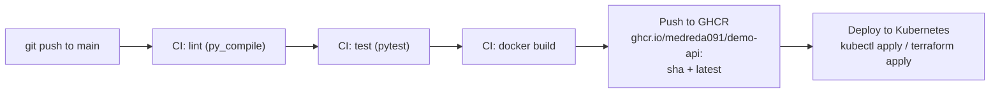

# cloud-native CI/CD + Kubernetes + Terraform


A minimal FastAPI microservice (`demo-api`) shipped the cloud-native way: **linted, tested, containerized, and deployed to Kubernetes** through a GitHub Actions pipeline, with the infrastructure also manageable as code via Terraform.

## Pipeline



## Quickstart

Pick the option that matches your setup.

### Option 1 — Docker only

```bash
cd app
docker build -t demo-api .
docker run -p 8000:8000 demo-api
curl localhost:8000/health   # {"status":"ok"}
```

### Option 2 — kind + kubectl

```bash
kind create cluster
kubectl apply -f k8s/
kubectl -n demo-api port-forward svc/demo-api 8080:80
curl localhost:8080/health   # {"status":"ok"}
```

### Option 3 — Terraform (any cluster)

```bash
cd terraform
terraform init
terraform apply -var="kubeconfig_path=~/.kube/config"
```

Works against any cluster — kind, minikube, Docker Desktop, or a managed
cloud cluster — just point `kubeconfig_path` at a valid kubeconfig.

## Project structure

```
.
├── app/                        # FastAPI microservice
│   ├── main.py                 # GET / and GET /health
│   ├── requirements.txt
│   ├── Dockerfile              # multi-stage build → python:3.11-slim
│   └── tests/test_health.py    # pytest + TestClient
├── .github/workflows/ci.yml    # lint → test → build → push to GHCR
├── k8s/                        # plain manifests (single source of truth)
│   ├── namespace.yaml
│   ├── configmap.yaml
│   ├── deployment.yaml         # 2 replicas, liveness/readiness probes
│   ├── service.yaml            # ClusterIP
│   ├── ingress.yaml            # nginx, demo-api.local
│   └── hpa.yaml                # autoscale 2→5 pods on CPU
└── terraform/                  # same manifests applied as code
    ├── main.tf                 # kubernetes provider + kubernetes_manifest
    ├── variables.tf            # kubeconfig_path, namespace, image
    └── outputs.tf
```

## What this demonstrates

- **CI/CD**: three-stage GitHub Actions pipeline (lint → test → build), with
  image pushes gated on `push` events and immutable SHA tagging alongside
  `latest`.
- **Container best practices**: multi-stage Dockerfile, slim runtime image,
  no build tools or caches shipped.
- **Kubernetes**: Deployment with 2 replicas, liveness/readiness probes on
  `/health`, resource requests/limits, ConfigMap-driven config, ClusterIP
  Service, Ingress, and HPA.
- **Infrastructure as Code**: the exact same `k8s/` manifests applied through
  Terraform (`kubernetes_manifest`), so imperative and declarative paths stay
  in sync.

## License

MIT — © 2026 Reda Ait Smouguen
